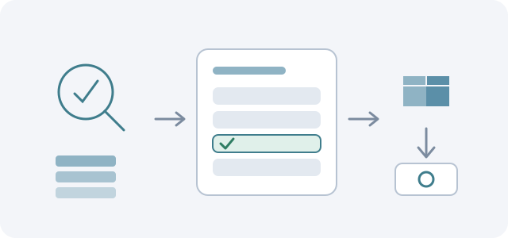

# Better Python for DSH

> 先探测，再复用，最后才是安装。为 DeepSeek Harness 提供的 Python 依赖安装护栏。

## 它解决什么问题

AI 编码代理在处理 Python 任务时，存在两类很难自知的系统性偏差。

### 一、重复安装

不检查本机已有依赖，直接执行安装命令。即使目标库已经存在，仍会触发下载、消耗时间，并可能改变既有版本。

### 二、污染长期环境

默认写入全局解释器，而非临时环境。一次实验即可留下数百 MB 依赖，事后难以区分哪些属于本次任务。

本插件把这两类动作从「默认行为」改为「需要人工确认的行为」。

## 一次真实的起因

这个插件来自一次可复现的观察。在一个数据可视化任务中，代理在本机已具备 matplotlib 的情况下，仍然执行了 `pip install matplotlib`。追问之后，对同一台机器上的两个 Python 解释器作了盘点：

| 库 | Framework Python 3.13 | DSH 内置 Python 3.12 |
|---|---|---|
| matplotlib | ✓ 3.10.8（2026-03 已安装） | ✗ |
| numpy / pandas | ✓ 2.4.2 / 3.0.1 | ✓ 2.3.5 / 3.0.1 |
| python-docx / python-pptx / lxml | ✗ | ✓ |

进一步检查发现，用户站点目录下另有一次 torch 安装，占用约 740 MB。

### 归因

1. **环境假设错位。** 代理沿用了「临时容器」的心智模型：在那种环境中安装是一次性成本，在本机却是永久副作用。
2. **安装带来虚假的确定性。** 安装成功会给出「问题已解决」的错觉，实际是把不确定性转移给了用户环境。
3. **真正的问题被回避。** 难点在于「应当使用哪个解释器」，而安装并没有回答这个问题——它只是绕过了判断。
4. **缺少低成本的查询手段。** 盘点本机解释器需要手工拼接命令，比直接安装更「麻烦」。

### 结论

这类行为无法靠「更小心」解决。代理没有恶意，它只是在遇到摩擦时选择了阻力最小的路径。因此需要的是机制：把正确路径变成最短路径。



---

## 三个能力

### 1. `python_env` —— 先查

扫描并去重以下几类解释器（最多 8 个）：

- `$VIRTUAL_ENV` 指向的环境
- 工作区中的 `.dsh-venv` / `.venv` / `venv` / `env`
- `PATH` 上的 `python3` / `python`
- `~/.dsh/dsh-runtimes/*/dependencies/python`（DSH 内置运行时）
- `/usr/bin/python3`

每个解释器只启动一个子进程，一次获取：Python 版本、是否为虚拟环境、`site-packages` 路径，以及每个被请求包是否可导入、版本号。返回结果直接给出 `servedBy`（已满足全部要求的解释器）与 `missingEverywhere`（所有解释器均缺失的包）。

常见的「导入名 ≠ 分发包名」情况已内置映射：`PIL` → `Pillow`、`docx` → `python-docx`、`sklearn` → `scikit-learn`、`yaml` → `PyYAML` 等。

`action: "create_venv"` 会在工作区创建虚拟环境，默认带 `--system-site-packages`，使 torch、matplotlib 等已安装的库在新环境中仍然可见，无需重复安装。

### 2. `python_install` —— 一次确认，一个对话框

1. 先探测目标解释器：若全部已存在，则不执行任何安装，直接回报现有版本。
2. 存在缺失时，弹出**一个**确认框（一次安装多个包同样只有一个），内容包含：目标解释器及版本、待安装的包、已存在的包、当前默认源，以及可选的源列表（默认源 / 清华 TUNA / 阿里云 / 中科大 / 腾讯云 / 豆瓣 / 取消）。
3. 如需使用其他镜像，直接在回答框中填写 URL，将覆盖所选条目。
4. 按用户的选择执行 `pip install -i <源>`，并将输出返回给模型。

取消、跳过或无回答，均不执行安装。

`action: "uninstall"` 走同一条通道：先探测实际安装的版本，弹出同一个确认框，确认后才卸载。

### 3. 安装拦截门 —— 裸命令一律拒绝

检查 `bash` / `pwsh` / `terminal` 中的 `pip install`、`pip uninstall`、`uv pip install`、`python -m pip install`：

| 情况 | 结果 |
|---|---|
| 包全部已存在 | **拒绝**，回报现有版本与解释器路径 |
| 缺包 / 安装 `-r` 依赖文件 / `-e .` | **拒绝**，并指明改走 `python_install` |
| `pip uninstall` | **拒绝**，并指明改走 `python_install` 的 `uninstall` |
| `sudo pip install` | 单调 guard **硬拒绝**（其他插件无法放行） |
| `--dry-run` / `--help` | 放行 |

即：不存在绕过用户确认的安装路径。

## 安装

### 从 Git（当前唯一可用的远程方式）

在 DSH 的 **Plugins → Add plugin** 中输入：

```
git+https://github.com/qianhanglv/dsh-better-python.git#2f012ddd8ad130ae08755e0cdfdf1c488e3794c1
```

该 commit 即当前发布版本（`v1.0.0`，也是插件索引中指向的同一个）。Git 安装要求本机具备 `git`。

如需跟随最新代码，可将 `#<commit>` 替换为 `#main`；但钉死 commit 更稳定，分支会漂移。

### 从本地目录（开发时）

在 Add plugin 中填写本包的绝对路径即可，修改代码即时生效，无需重新发布。

### 从 npm（尚未发布）

计划发布为 `dsh-better-python`。发布后可直接在 Add plugin 中输入包名，比 Git 方式更快；**在此之前请使用上述两种方式**。

## 通过插件广场（索引）发现

本项目自带一份插件市场索引，托管于 GitHub Pages：

```
https://qianhanglv.github.io/dsh-better-python/market/index.json
```

在 DSH 的 **Plugins → Discover → 索引源** 中添加该 URL，即可搜索到本插件并一键安装。

> **Discover 为实验性功能**，由 `@deepseek-ai/dsh-experimental-plugin-market-bundle` 提供，默认安装中不包含。需要先在 **Add plugin** 中安装它，才能看到 Discover 标签页。

索引内容维护在 [`market/index.json`](market/index.json)：新增版本时追加一条 `versions[]`（精确 SemVer、Unix 秒的 `publishTimestamp`、指向该版本的 `source`）。当前条目使用 Git 源并钉在具体 commit 上；发布到 npm 后可改为 `{"type": "npm"}`。

## 配置

打开 **Plugins → Better Python for DSH**，页面中部会显示配置区：

| 配置项 | 作用 |
|---|---|
| **默认安装源** | `python_install` 确认框中预选的源；仍可在单次确认中切换 |
| **自定义 index URL** | 选择「自定义镜像」时出现，仅接受 http/https |
| **额外的 pip 参数** | 内置白名单不足时由用户补充，空格分隔 |

「额外的 pip 参数」的三条约束：

- **仅由人修改**：模型只读该列表，不能追加；
- **改变安装源或安装目标的参数永不生效**（`-i`、`--index-url`、`--find-links`、`--target`、`--user`、`--break-system-packages` 等）；
- 按 flag 名匹配，因此 `--only-binary=:all:` 中的值由调用方决定。

配置保存在 profile 中，重装不会丢失。

## 设计取舍

本插件的目标不是「限制 AI」，而是让安装行为在执行前可读。三条原则：

**① 确认框必须是可信契约。** 框内声明「源 = 清华、目标 = 解释器 X」时，实际执行不得被 `-i` 或 `--target` 改写。因此改变源与目标的参数被永久禁用——一旦放行，用户的确认就变成了对一个被替换操作的确认，比没有确认更糟。

**② 每个拒绝都要点名下一步。** 拒绝信息会说明：改用哪个工具、去哪个配置项添加参数，并明确禁止改用其他命令绕过。留下封闭回路，才是促使人绕路的根本原因。

**③ 扩展权交给用户，不交给对话框。** 白名单不足时，由人在设置页添加，而不是在任务过程中点一次「记住」。前者是显式决定，后者会退化为习惯性的摩擦消除，权限面会在无人注意时扩张。

## 安全与隐私

公开分发意味着他人会运行这段代码，因此需要说明其行为：

- **会**扫描本机 Python 解释器，读取其 `site-packages` 元数据（只读）；
- **会**在用户确认后执行 `pip install` / `pip uninstall`，写入目标解释器的环境；
- **会**在 profile 配置中保存上述三个配置项；
- **不会**联网（除 `pip` 自身按所选源下载）、不会上传任何数据、不含遥测。

## 兼容性

面向 **DSH 0.2.2-rc.2** 开发与测试。依赖 `ctx.userQuestions`、`tools/pre-execute`、`plugins.bundle.config` 接口，较早版本可能不提供。

`package.json` 未写死 `engines.dsh`：DSH 以 SemVer 判定兼容性，而预发布版本（`0.2.2-rc.2`）低于 `0.2.2`，写 `^0.2.2` 反而会将当前版本判为不兼容。

## 开发

```bash
pnpm install          # 安装依赖
node parse-test.mjs   # 运行解析与校验的单元测试（54 项）
pnpm pack --dry-run   # 查看将进入 tarball 的文件
```

代码只有两个文件，无构建步骤：

- `index.js` —— Host 半：工具注册、探测、拦截门、确认框
- `client.js` —— 浏览器半：手写 `window.__ModuleLoader__` 模块，渲染配置区

## 已知限制

- 拦截门依据的是**字面量命令**。`python -c "subprocess.run(['pip','install','x'])"` 这类间接调用、`make` 中封装的安装、`conda` / `poetry` 的其他子命令均无法覆盖。其定位是防止疏忽，而非限制绕过。
- 解释器探测上限为 8 个；每次安装前增加一次探测（约 0.1–0.5 秒/解释器），结果缓存 30 秒。
- 确认框依赖 `ctx.userQuestions` 服务；不可用时工具会明确报告「未安装」，不会静默降级。

## 版本记录

见 [CHANGELOG.md](CHANGELOG.md)。

## License

[MIT](LICENSE)
